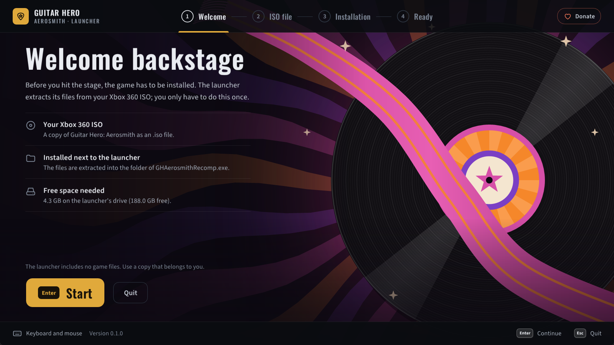
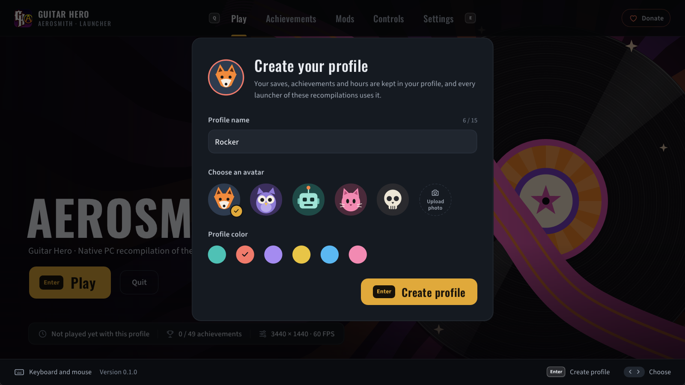
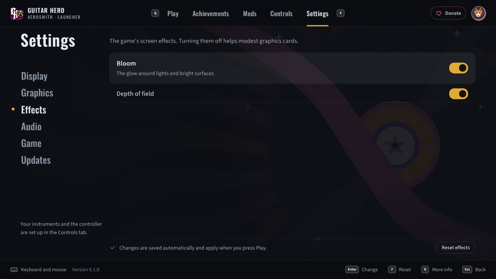
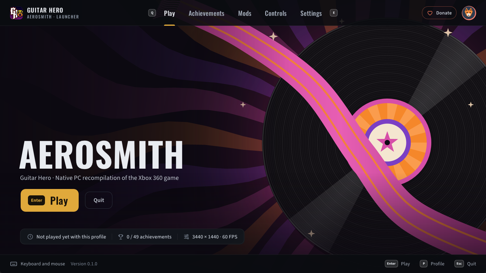
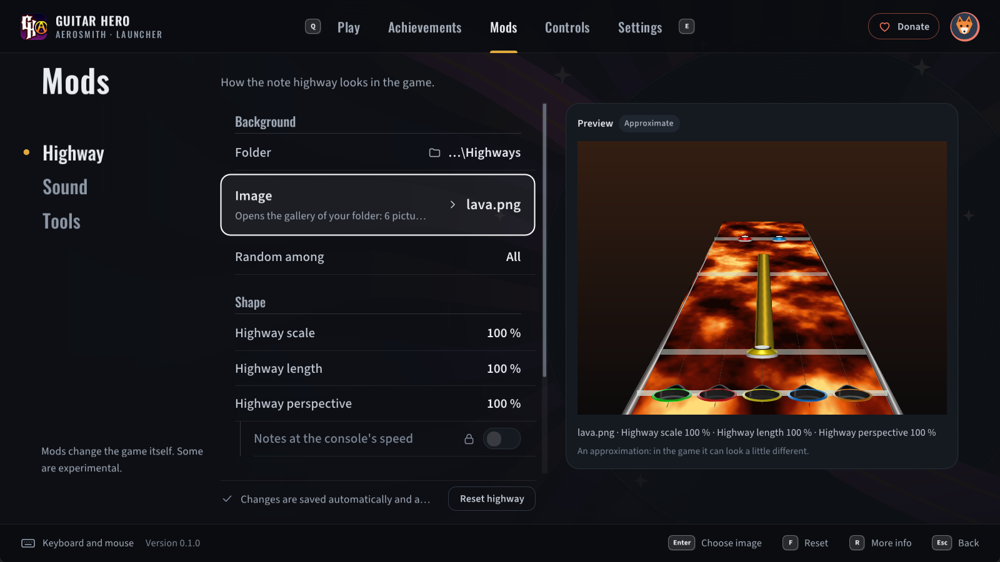
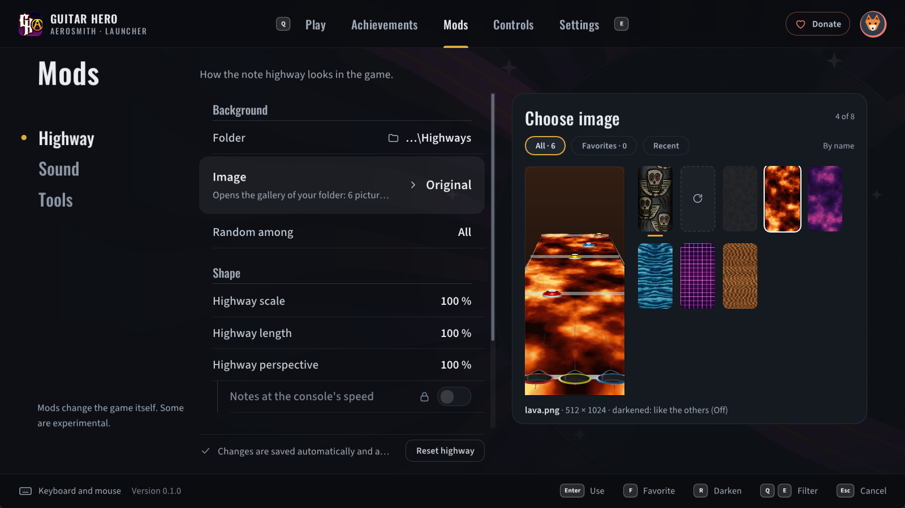
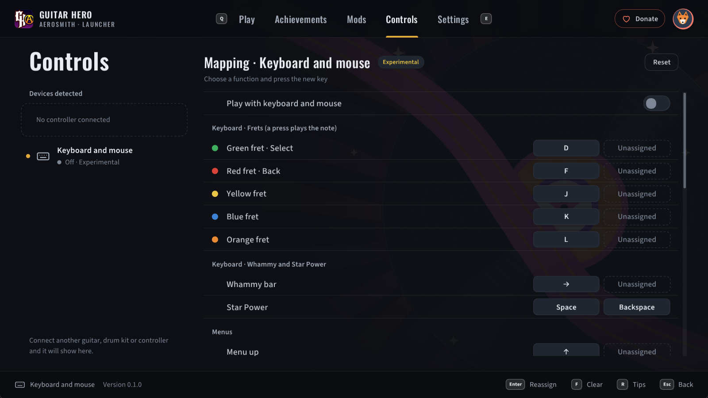
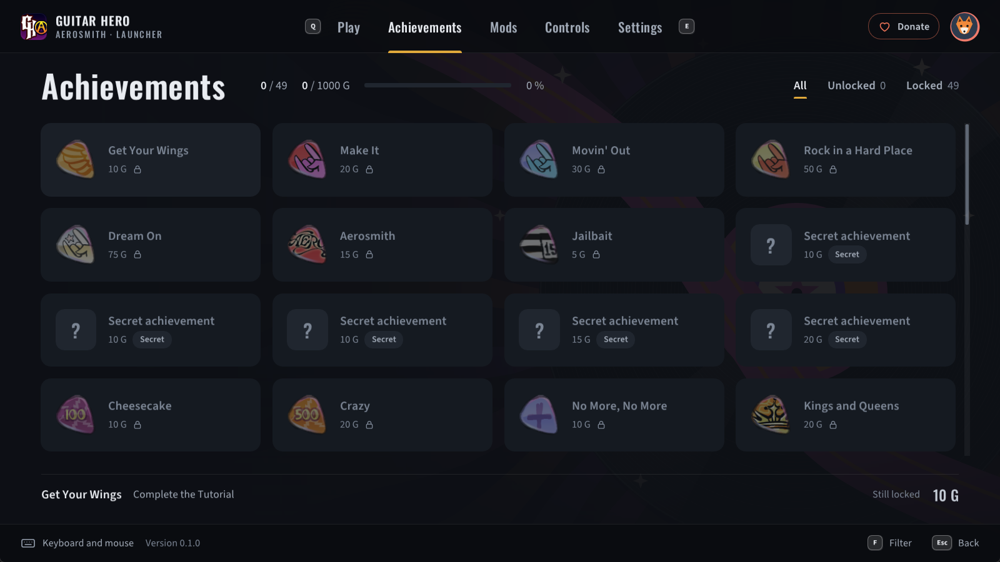
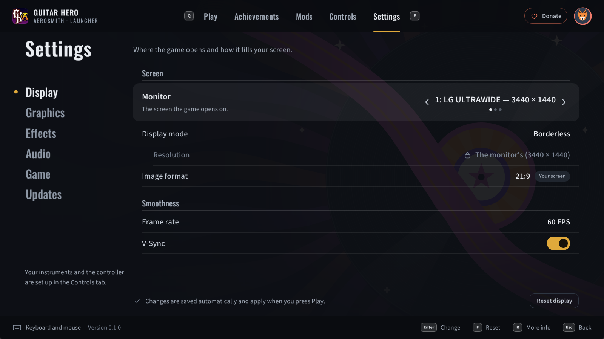
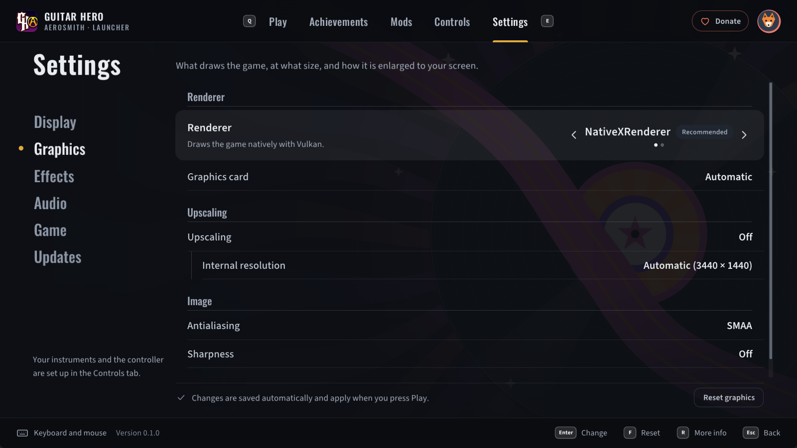

  

<h1 align="center">GHAeroRecomp</h1>

  
  

  
  
  
  
  

🎸 **Play Guitar Hero: Aerosmith on your PC, natively.** The Xbox 360 game (2008), recompiled to run directly on
Windows: no emulator to set up, sharp graphics, wide screens, high frame rates, and your Xbox 360 guitar.

> [!IMPORTANT]
> 💿 **You need your own original copy of the game.** This project does not include any of the game's files, and
> never will.
> - To play, you need an Xbox 360 copy of *Guitar Hero: Aerosmith* that you own (tested with the disc sold in the
>   USA).
> - You make an image (ISO) of your own disc, and the launcher installs the game from it.
> - Please do not ask for the game's files, and do not share them or links to them.
>
> This project is not affiliated with or endorsed by Microsoft, Activision or the game's developers.

> [!NOTE]
> 🤘 **First release.** Songs have been played with an Xbox 360 guitar and with a controller. Guitar Hero: Aerosmith
> runs on Guitar Hero III's engine, and what [GHMetalRecomp](https://github.com/ElGuslml/GHMetalRecomp) fixes is here
> too, with the mods and the launcher of [GH5Recomp](https://github.com/ElGuslml/GH5Recomp) and
> [GHWoRRecomp](https://github.com/ElGuslml/GHWoRRecomp). If something goes wrong, please
> [tell us](#-reporting-a-problem)!

> [!WARNING]
> ⚠️ **Not tested yet:** AMD graphics cards, and songs with two players (co-op and battle). If you play with either and
> something goes wrong, please report it in [issues](https://github.com/ElGuslml/GHAeroRecomp/issues) or on
> [Discord](https://discord.gg/XQtM5TmNs8).

## 🎮 How to play

1. **Download** the latest version from [Releases](https://github.com/ElGuslml/GHAeroRecomp/releases/latest):
   - **the installer** (`GHAeroRecomp-...-setup.exe`): installs for your Windows user, no administrator rights needed,
     with a Start menu shortcut; or
   - **the zip** (`GHAeroRecomp-...-win64.zip`): extract it into any folder you can write to (not `Program Files`).
2. **Open GH Aerosmith Launcher.** The first time, it asks for the ISO of your game, checks it and installs the game
   files (about 4.3 GB), then asks you to create your profile. You only do this once.
3. **Pick your settings and press PLAY.** 🎉
4. **Calibrate:** in the game's options, run the lag calibration once, so that the notes match what you hear on your
   own speakers or headphones.

  
  

The first run: the launcher checks your ISO, installs the game from it, and asks for your profile.

From then on, the launcher keeps itself up to date: when a new version comes out, it offers to install it for you.

### 💻 What you need

- Windows 10 or 11 (64-bit).
- A graphics card with up-to-date drivers that support Vulkan (practically any card from the last ten years).
- The [Microsoft Visual C++ Redistributable](https://aka.ms/vs/17/release/vc_redist.x64.exe) (most PCs already
  have it).
- An Xbox 360 guitar. Any other controller works too, and so does the keyboard.

## ✨ Features

- 🎸 **Your guitar:** an Xbox 360 guitar plays as on the console, whammy bar and Star Power included. Each guitar's and
  controller's buttons can be reassigned in the launcher, and a whammy bar that reads pressed at rest or does nothing
  (some third-party guitars) can be calibrated there.
- 🎮 **A controller plays the game's own way:** Guitar Hero: Aerosmith has its own controller layout, and it is used
  here: the frets are LT, LB, RB, RT and A, and there is no strum (pressing a fret plays its note). Star Power is on the
  D-pad or Back, and the whammy bar on either stick. **The keyboard** plays as a guitar: the frets on D, F, J, K and L
  (a fret key plays its note in a song), Star Power on Space, the whammy bar on the right arrow.
- 🖥️ **Sharp, native graphics:** the game is drawn by your graphics card at your screen's resolution, with smooth
  edges (antialiasing) and sharper textures.
- 🚀 **No first-time stutters:** "Compiling shaders" prepares every graphics combination the game uses for your
  graphics card before you play, in a moment, only the first time and after an update.
- 🔍 **Upscaling:** AMD FSR 1 or NVIDIA NIS, on any graphics card, with their quality and sharpness: for a 4K screen
  or a slower graphics card ([how they compare](https://github.com/ElGuslml/GHMetalRecomp/blob/main/docs/scaling.md)).
- ⚡ **High frame rates:** 60 FPS as on the console, or 72, 75, 90, 100, 120, 144, 160, 165 or 240 FPS if your monitor
  supports it (experimental), and 300, 360, 480 or Unlimited with V-Sync off (experimental: with V-Sync on the game
  runs at your monitor's rate). The songs keep their speed and stay in sync. V-Sync is on by default (no tearing, the
  game in step with your monitor, without V-Sync's usual delay); leave it on with a G-Sync or FreeSync monitor too.
- 🔈 **Louder when you need it:** the volume goes up to 200 % in **Settings → Audio**, for a game that sounds quiet next
  to the rest of your PC (above 100 % its loudest moments can distort). *(By [Panchovix](https://github.com/Panchovix).)*
- 🛣️ **Your note highway (optional):** in the launcher's **Mods** tab: your own pictures on the highway, from a
  gallery of your folder with favorites, one picture or a random one at each song, bright ones darkened so that the
  notes stand out, all previewed with the game's own highway and notes (read from your game files). Every guitarist
  has a highway of his own in this game: your picture replaces all of them. The highway smaller or larger when you
  play alone (80-120 %), longer so that the notes show up earlier at the same speed, as in Clone Hero (up to 170 %,
  the highway continued in its own perspective), its perspective flatter or steeper (with the notes at the console's
  speed if you want), the community's black highway, and the venue seen through it. In **Mods → Sound**, the whammy
  bar's sound effect, and how much of your instrument stays when you miss a note (0-100 %; the console mutes it). All
  as on the console by default.
- 🖼️ **Custom textures:** put an image named by a texture's hash in the `textures` folder next to the game and it
  replaces that texture; Joe Perry's note highway is `3452F9C82296C39C` (the others are in
  [the mods' notes](docs/mods.md)). The game can log and dump its textures by hash to find the others.
- 📺 **Wide and ultrawide screens:** the stage fills 16:9, 21:9 and wider screens, while the note highway, the HUD and
  the menus keep their shape in the center.
- 🎬 **Straight to the music (optional):** the intro videos can be skipped, so the main menu comes sooner.
- 👤 **Profiles:** your saves, achievements and playtime in a profile shared by all the ElGus Recomps launchers.
- 👥 **Play together:** the first controller to press a button plays with your profile; the other controllers join as
  its guests, as on the Xbox 360.
- 🏆 **Achievements:** a notification when you unlock one, and all 49 in the launcher or with F7 in the game.
- 🌍 **Languages:** English, French, German, Italian and Spanish, in the game and in the launcher.
- 🔄 **Automatic updates** from this page.

## 🔧 Better than the original

Some problems come from the game itself and happen on an Xbox 360 too. They are fixed here, and each fix can be turned
off (the [notes](docs/README.md) say how):

- ⏱️ **Songs drifting out of sync.** On the later Xbox 360 models the music slowly falls behind the notes during a
  song, until you pause: the game corrects its clock for the first consoles' timer, which runs 0.25 % slow, and the
  later ones' does not. Here the game's clock runs at the right rate, and whole songs stay in sync
  ([details](docs/fixes-from-gh-metallica.md#the-songs-clock)).
- 👏 **Crowd claps out of time.** With Star Power on, the crowd claps on the beat, but the claps ignored your lag
  calibration and came late by it. They follow the calibration now, as the music does
  ([details](docs/fixes-from-gh-metallica.md#the-crowds-claps-on-star-power)).
- 🎛️ **Screen effects you can turn off.** The bloom and the depth of field each have a switch in the launcher's
  **Settings → Effects** (both on by default, as on the console) ([details](docs/screen-effects.md)).

  

## 🧭 GH Aerosmith Launcher

Everything is set up from **GH Aerosmith Launcher**, with the mouse, the keyboard or a controller:

  

| Tab | What you find there |
|---|---|
| ▶️ **Play** | Start the game, see your settings and achievements at a glance, and a new version when there is one. |
| 🏆 **Achievements** | All 49 achievements, the ones you have unlocked and when. |
| 🧩 **Mods** | **Highway:** your pictures for the note highway (a gallery with favorites, one picture or a random one at each song, bright ones darkened), previewed with the game's own highway; its scale with one player, its length (the notes seen earlier at the same speed), perspective (the notes at the console's speed with it, if you want), style (original or dark) and opacity. **Sound:** the whammy's sound effect, the instrument's volume on a miss. **Tools:** the developer's keys. |
| 🎮 **Controls** | Your guitars, controllers and keyboard: what each button or key does, and a whammy bar's calibration. |
| ⚙️ **Settings** | **Display:** monitor, fullscreen or window, resolution, image format (fill a wide screen or keep 16:9), frame rate, V-Sync (on by default: no tearing, without V-Sync's usual delay; leave it on with a G-Sync or FreeSync monitor too). **Graphics:** renderer, graphics card, upscaling (AMD FSR 1, NVIDIA NIS) with its quality and the internal resolution, antialiasing, sharpness, texture sharpness. **Effects:** the game's screen effects. **Audio:** output device, channels, volume (up to 200 %), mute in the background, Low latency audio. **Game:** the game's and the launcher's language, the intro videos skipped, the game's own debug menu. **Updates:** your version, and new ones when they come out (the betas too, if you choose); Play shows a new one. |
| 👤 **Profile** | Your picture at the top right: hours played, streaks, your week, your games and your favorite achievements. |

  
  

Mods: a picture of your own on the note highway, previewed with the game's own highway, and the gallery of your folder (favorites, darkening).

  
  

Controls: what each key does with the keyboard as a guitar (each guitar and controller has a page like it); and the 49 achievements.

  
  

Settings: Display (your screen, window or fullscreen, the image format, the frame rate, V-Sync) and Graphics (the renderer, the graphics card, upscaling, antialiasing).

Your choices are saved as soon as you make them. When you quit the game, the launcher comes back.

**Tips:**
- 🚪 On the title screen or in the main menu, press **B** (the red fret) to quit the game.
- 🎮 **Steam Big Picture:** add `GH Aerosmith Launcher.exe` as a non-Steam game and play from your couch.
- 🛡️ **"Windows protected your PC":** the programs are not signed by a company, so Windows may warn you the first
  time. Click **More info**, then **Run anyway**.

## 🐞 Reporting a problem

Something looks wrong, sounds wrong, or crashes? Tell us on [Discord](https://discord.gg/XQtM5TmNs8) or open an
[issue](https://github.com/ElGuslml/GHAeroRecomp/issues), with:
- where in the game it happened, and a screenshot if you can;
- the latest files in the `logs` folder next to the game: `ghaerosmith_NNN.log`, and if the launcher misbehaved,
  `launcher_NNN.log` (with its `.dmp` file if there is one).

If something looks wrong, try the other renderer: in the launcher, **Graphics → Xenos** (it emulates the Xbox 360's
graphics instead), and tell us whether it happens there too.

### Known issues

- 👥 Songs with two players (co-op and battle) have not been tested yet.
- 🎚️ With some controllers the whammy bar reads partly pressed (about 40 %) until you first move it.
- 🎬 In the opening video, about a second of colored lines at the top of the screen as the Neversoft logo comes in.
- ⌨️ Playing with the keyboard is experimental.
- 🔊 Some USB audio interfaces add delay in Windows' shared audio mode (a Focusrite Scarlett about 20 ms more than
  a motherboard's audio): calibrate the lag in the game's options.
- ⚡ Above 60 FPS is experimental: something may still run too fast.
- 🖼️ Your highway pictures and custom textures need NativeXRenderer (the default renderer): with Xenos the highway is
  the game's own.
- ✨ With the Xenos renderer, or if you skip "Compiling shaders", the first time an effect appears it may show up a
  moment late.

## ❤️ Support

If you enjoy rocking out to Aerosmith on your PC, you can support the work on [Ko-fi](https://ko-fi.com/elguslml) ☕.
For news about the next updates, follow [@ElGuslml on X](https://x.com/ElGuslml) and join the
[Discord](https://discord.gg/XQtM5TmNs8). And if you'd like more Xbox 360 classics running natively, the other
recompiled games are at [ElGus Recomps](https://github.com/ElGuslml/ElGusRecomps).

## 🛠️ For developers

GHAeroRecomp is a *static recompilation*: the game's original Xbox 360 code is translated to C++ and compiled for
Windows, on top of the [ReXGlue SDK](https://github.com/rexglue/rexglue-sdk). It is drawn by
[NativeXRenderer](https://github.com/ElGuslml/NativeXRenderer), a renderer that draws the game's graphics calls
natively on Vulkan.

- [Building and developing](docs/development.md): requirements, building from source, configuration, how the SDK is
  modified.
- [`docs/`](docs/README.md): a short note on each problem found and how it was solved.

## 🚧 In the works

New features on the way:
- 🌐 **Online play:** the game's online modes with your friends.
- 🐧 **Linux and Steam Deck:** a port to play there too.
- ✨ **And more...**

Follow along on [Discord](https://discord.gg/XQtM5TmNs8) and on [X](https://x.com/ElGuslml).

## 🤖 A note about AI

This project is developed with the help of AI ([Claude](https://claude.ai), by Anthropic). I know it's a touchy
subject for many people, so I want to be open about it and explain how the work is done:

- 🎮 **The game is still the original game.** Its code is translated by the ReXGlue recompiler, not written by an
  AI, so it plays as it did on the Xbox 360: the same songs, the same charts, the same scoring.
- 🧪 **Every change is tested by hand.** I play each fix and improvement myself, with an Xbox 360 guitar, before it
  is released, and check it against how the game behaves on the console: the notes in time with the music, its
  graphics, its sound and how it feels to play.
- ⚡ **Performance is measured, not guessed.** CPU use, frame times, GPU time and the sync between the notes and the
  music are measured on real hardware before and after each change, so that the game runs smoothly and doesn't
  waste your computer's resources.
- 🙌 **Claude helps with the research and the code;** the decisions, the testing and the care for the game are mine.

If something doesn't run as well as it should, it's a bug like any other: tell us on
[Discord](https://discord.gg/XQtM5TmNs8) or open an [issue](https://github.com/ElGuslml/GHAeroRecomp/issues), and
it will get fixed. Thanks for giving this game a try! 🧡

## 🙏 Credits

- [ReXGlue SDK](https://github.com/rexglue/rexglue-sdk), whose runtime is derived from [Xenia](https://xenia.jp).
- [GHMetalRecomp](https://github.com/ElGuslml/GHMetalRecomp), whose fixes this game shares, and
  [GH5Recomp](https://github.com/ElGuslml/GH5Recomp) and [GHWoRRecomp](https://github.com/ElGuslml/GHWoRRecomp), whose
  mods it shares.
- [extract-xiso](https://github.com/XboxDev/extract-xiso), for extracting game files.
- [Panchovix](https://github.com/Panchovix), who contributed the volume up to 200 % and the one-step present in
  NativeXRenderer.
- Developed by Gustavo Garcia with the help of Claude (Anthropic): see [the note about AI](#-a-note-about-ai).

## 📜 License

MIT for this project's own code (see [`LICENSE`](LICENSE)). The ReXGlue SDK and the other components keep their
own licenses (see [`THIRD_PARTY_NOTICES.md`](THIRD_PARTY_NOTICES.md)). Guitar Hero: Aerosmith, its code and its
assets belong to their respective owners.
